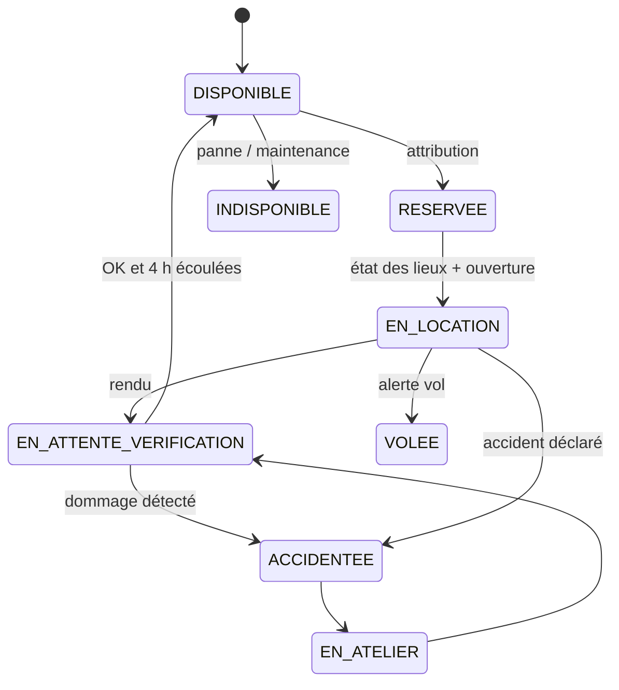

# Idées de projet : location de voiture 100 % sur smartphone

## 1. Le concept en une phrase

**« ZeroDesk »** (nom provisoire) : une **app mobile (PWA)** pour le client et un **back-office web** pour les équipes (comptoir, parc, atelier). Ensemble, ils gèrent tout le cycle d'une location (réservation → vérification d'identité → trouver la voiture → ouverture → rendu → inspection) **sans passer au comptoir** et **sans toucher au câblage de la voiture**.

> Idée clé pour respecter « pas de modification électronique » : on utilise **l'API constructeur des voitures connectées** (les voitures récentes l'ont toutes déjà : position, kilométrage, carburant, verrouillage, clignotants). Exemple d'agrégateur réel : *Smartcar API*. Pour le hackathon, on **simule** cette API avec un faux serveur de voitures.

---

## 2. Les acteurs

| Acteur | Interface | Ce qu'il fait |
|---|---|---|
| **Client** | App mobile (PWA) | Réserve, envoie ses papiers, trouve la voiture, l'ouvre, fait l'état des lieux, la rend, discute, appelle l'assistance |
| **Agent comptoir** | Back-office web | Valide les dossiers douteux, répond au chat, gère les imprévus, lit le rapport de nuit |
| **Agent parc** | Back-office (mobile aussi) | Reçoit des missions : vérifier, déplacer, nettoyer une voiture, récupérer une clé |
| **Atelier** | Back-office web | Reçoit les voitures « accidentées », compare les photos avant/après, remet en service |
| **Système** | Backend + tâches planifiées | Applique les règles (blocage de 4 h, statuts), produit le rapport de nuit, envoie les alertes vol |

---

## 3. Le parcours client, étape par étape

### Avant d'arriver (à la maison / dans l'avion)
1. **Création de compte et réservation** (dates, catégorie de voiture).
2. **Vérification d'identité (KYC)** :
   - photo de la **carte d'identité** + du **permis** → OCR pour lire nom, date de naissance, validité, catégorie B ;
   - **selfie** → comparaison du visage avec la photo de la carte d'identité ;
   - **carte bancaire** → on vérifie que le **nom du titulaire = nom sur la CNI = nom sur le permis** ; **pré-autorisation** de la caution (Stripe en mode test).
   - Si un contrôle automatique échoue → le dossier part chez un **agent comptoir** pour validation manuelle (le matin si c'est la nuit).
3. **Contrat** généré en PDF, signé dans l'app (signature au doigt ou case + code OTP), puis **envoyé par e-mail**.

### À l'aéroport
4. **Attribution de la voiture** au dernier moment (uniquement parmi les voitures en statut `DISPONIBLE` **et** libérées depuis plus de 4 h).
5. **Trouver la bonne voiture** :
   - numéro de **place exacte** (ex. : *Parking P2, niveau -1, allée C, place 47*) + plan / carte ;
   - **photo de la voiture + plaque** ;
   - bouton **« Faire clignoter / klaxonner »** (commande API constructeur, aucun câblage) ;
   - QR code ou tag NFC sur la place, à scanner pour confirmer « je suis devant la bonne voiture ».
6. **État des lieux de départ** obligatoire avant le déverrouillage : photos guidées (avant, arrière, 4 côtés, intérieur, compteur) + niveau de carburant et kilométrage **relevés automatiquement par l'API** puis confirmés par le client.
7. **Ouverture** :
   - **Clé virtuelle** : le téléphone déverrouille la voiture via l'API (jeton signé, valable seulement pendant la location) ;
   - a changer/ il faut forcément la clé physique
   - ou **casier à clés connecté** sur le parking : il s'ouvre avec un **QR code / code à usage unique** affiché dans l'app.

### Pendant la location
8. **Chat** avec l'agence dans l'app + bouton **« Appeler l'assistance »** (lien `tel:` ou appel VoIP).
9. **Déclarer un problème** : panne, accident (constat guidé avec photos et position), crevaison…

### Au retour
10. L'app guide vers une **zone de retour** et une **place libre**.
11. Le client **scanne le QR/NFC de la place** → on enregistre la **place exacte** (et on la recoupe avec le GPS de la voiture).
12. **État des lieux de retour** : photos/vidéo guidées + carburant + kilométrage (API).
13. **Clé** : dépôt dans le **casier connecté** (il détecte la présence de la clé grâce à un tag RFID et se verrouille, aucun humain n'intervient) ou simple fin de la clé virtuelle.
14. Verrouillage à distance, contrôle de bonne fermeture → **fin de location**, facture et contrat final par e-mail.
15. La voiture passe en `EN_ATTENTE_VERIFICATION` et **ne peut pas être relouée avant 4 h**.

---

## 4. Les statuts de la voiture (machine à états)

- **Règle des 4 h** : on enregistre `fin_location_at` et on n'autorise l'attribution que si `now() >= fin_location_at + 4h` **et** que le statut est `DISPONIBLE`. On l'applique **côté base de données** (contrainte ou fonction SQL), pas seulement dans l'interface.
- Le statut simple demandé (accidentée / en attente de vérification / bon état) correspond à `ACCIDENTEE` / `EN_ATTENTE_VERIFICATION` / `DISPONIBLE`.

---

## 5. Fonctions côté entreprise

### « Ping » de la voiture (position en temps réel)
- Seuls les rôles **staff** y ont accès (comptoir, parc, admin) ; **jamais en continu**, uniquement **à la demande**.
- Chaque ping demande un **motif** (vol, client injoignable, retour non conforme…), il est **enregistré dans un journal d'audit** (qui, quand, pourquoi) et le client peut être notifié. → conformité **RGPD**, un vrai point fort pour la filière cyber.
- Exception automatique : **alerte vol** si la voiture bouge alors qu'aucune location n'est en cours, ou si elle sort d'une zone (géorepérage).

### Gestion de 7 000 voitures (uniformiser)
- **Un seul modèle de données** pour toutes les voitures, quelle que soit la marque : on met un **adaptateur** devant chaque API constructeur (patron de conception *Adapter*) → `getPosition()`, `getFuel()`, `getMileage()`, `lock()`, `unlock()`, `flash()`.
- Tableau de bord avec **filtres** (statut, parking, catégorie), **carte** de la flotte, compteurs.
- Démo : un **simulateur** génère 7 000 voitures pour montrer que tout tient la charge.

### Missions pour le parc et l'atelier
- Création automatique de tâches : « vérifier la voiture AB-123-CD place 47 » (après chaque retour), « récupérer la clé non déposée », « voiture accidentée → atelier ».
- **IA de détection de dommages** : comparaison des photos départ/retour → signale les nouvelles rayures ou bosses → l'atelier confirme ou rejette.

### Rapport de nuit (les agents ne travaillent pas la nuit)
Généré automatiquement à **7 h** (tâche planifiée/cron), envoyé par e-mail et visible sur le tableau de bord :
- locations démarrées et terminées pendant la nuit ;
- voitures rendues → à vérifier (avec places exactes) ;
- dommages signalés par l'IA, accidents déclarés ;
- écarts carburant/kilométrage, clés non déposées, voitures mal garées ;
- alertes vol, dossiers d'identité en attente de validation manuelle, messages de chat non lus ;
- bonus : **résumé en langage naturel** généré par un LLM (« 3 voitures à vérifier en priorité… »).

### Imprévus
| Imprévu | Réponse du système |
|---|---|
| Voiture non disponible (panne, retard du client précédent) | **Réattribution automatique** d'une voiture équivalente ou supérieure + notification |
| Accident | Déclaration guidée (photos, position, constat) → statut `ACCIDENTEE` → atelier |
| Vol | Alerte de géorepérage → ping autorisé → statut `VOLEE` → procédure |
| Clé non déposée / casier plein | Alerte + mission pour l'agent parc + pénalité éventuelle |
| Identité refusée | Dossier en validation manuelle, aucune voiture débloquée |
| Téléphone mort | Code de secours / appel assistance qui peut ouvrir à distance après vérification |

---

## 6. Technologies conseillées (réalistes en 24 h)

### Stack recommandée
| Besoin | Techno | Pourquoi |
|---|---|---|
| App client | **React + Vite en PWA** (ou Next.js) + Tailwind | Pas besoin des stores, appareil photo accessible, un seul code pour mobile et PC |
| Back-office | Même projet React (routes `/admin`) | Gain de temps |
| Backend / BDD / Auth / Stockage photos / Temps réel (chat) | **Supabase** (PostgreSQL + Auth + Storage + Realtime + RLS) | Énorme gain de temps, la sécurité par rôle (Row Level Security) est intégrée |
| Services IA | **FastAPI (Python)** | OCR, comparaison de visages, détection de dommages |
| OCR des papiers | **EasyOCR** ou **PaddleOCR** + lecture de la **MRZ** (bande en bas de la CNI) | Plus fiable de lire la MRZ que tout le document |
| Comparaison de visages | **DeepFace** ou `face_recognition` | Simple à brancher |
| Dommages carrosserie | **YOLOv8 (Ultralytics)** avec un dataset public « car damage » (Roboflow) **ou** un modèle LLM vision qui compare les 2 photos | Le LLM vision est plus rapide à mettre en place en 24 h |
| Paiement | **Stripe en mode test** (pré-autorisation de caution) | Gratuit, bien documenté |
| Contrat PDF + e-mail | `react-pdf` / `pdfkit` ou WeasyPrint + **Resend** / SMTP (Mailtrap pour la démo) | |
| Carte | **Leaflet + OpenStreetMap** | Gratuit, sans clé d'API |
| Voitures | **Simulateur Python** qui imite une API constructeur (position, carburant, km, lock/unlock/flash) | On n'a pas de vraies voitures |
| Rapport de nuit | `pg_cron` (Supabase) ou **APScheduler** dans FastAPI | |
| Assistance | lien `tel:` (suffit) ; bonus : WebRTC | |
| Bonus matériel | **ESP32 / Arduino + servomoteur + lecteur RFID** = maquette de casier à clés qui s'ouvre avec un QR/code de l'app | Effet « wow » énorme en démo |

### Alternative si l'équipe préfère tout faire en Python
FastAPI + PostgreSQL + SQLAlchemy + WebSockets pour le chat, et un front React. C'est plus long à monter que Supabase : à éviter si l'équipe n'est pas à l'aise.

---

## 7. Volet cybersécurité (à mettre en avant, c'est votre filière !)
- **Rôles stricts** (client / comptoir / parc / atelier / admin) avec RLS : un client ne voit que **ses** locations.
- **Ping GPS** : accès restreint au staff + motif obligatoire + **journal d'audit** non modifiable.
- **Clé virtuelle / code casier** : jeton **signé (JWT)**, à **durée courte**, **usage unique**, lié à une location et à un appareil.
- **Pièces d'identité** chiffrées dans un stockage privé (URL signées temporaires), **suppression automatique** après X jours (RGPD).
- Authentification forte : **OTP** par SMS/e-mail ou passkey à la signature du contrat et à l'ouverture.
- Limitation du nombre de requêtes (*rate limiting*) sur les endpoints sensibles (unlock, ping).
- Anti-fraude : nom CB ≠ nom CNI → blocage ; détection de selfie photo d'écran (bonus).

---

## 8. Ce qu'il faut faire en priorité (MVP) et les bonus

**MVP (obligatoire pour la démo)**
- [ ] Inscription + upload CNI/permis/CB (même avec une vérification simplifiée)
- [ ] Réservation + attribution d'une voiture qui respecte la **règle des 4 h**
- [ ] Écran « trouver ma voiture » (place, carte, bouton clignoter simulé)
- [ ] État des lieux photo départ/retour + carburant/km du simulateur
- [ ] Unlock/lock simulé + enregistrement de la place exacte au retour (scan QR)
- [ ] Back-office : liste/carte de la flotte, statuts, ping avec journal
- [ ] Chat client ↔ agence
- [ ] Contrat PDF envoyé par e-mail
- [ ] Rapport de nuit (même généré par un bouton pour la démo)

**Bonus (si le temps le permet)**
- [ ] IA de détection de dommages
- [ ] OCR + comparaison de visages
- [ ] Maquette de casier à clés ESP32
- [ ] Résumé du rapport de nuit par un LLM
- [ ] Alerte vol par géorepérage
- [ ] Simulation de 7 000 voitures

---

## 9. Répartition de l'équipe (exemple pour 4 à 5 personnes)
| Personne | Rôle |
|---|---|
| 1 | Front client (PWA) : parcours de location, appareil photo, état des lieux |
| 2 | Back-office : tableau de bord, carte, missions, rapport de nuit |
| 3 | Supabase : schéma BDD, RLS, règle des 4 h, chat temps réel, journal d'audit |
| 4 | Python : simulateur de voitures + services IA (OCR, dommages) |
| 5 | Pitch, maquettes Figma, données de démo, tests, (casier ESP32 si matériel) |

## 10. Planning sur 24 h
| Heures | Objectif |
|---|---|
| H0 – H2 | Choix final, maquettes rapides, schéma de BDD, répartition, mise en place du repo et de Supabase |
| H2 – H8 | Socle : auth, BDD, simulateur, écrans principaux |
| H8 – H14 | Parcours complet client de bout en bout + back-office branché |
| H14 – H16 | **Point d'étape** : tout est connecté ? On coupe ce qui ne marche pas |
| H16 – H20 | Bonus (IA, casier, rapport de nuit), corrections |
| H20 – H22 | **Gel des fonctionnalités**, données de démo propres, tests du scénario |
| H22 – H24 | Pitch + répétition de la démo (au moins 2 fois) |

## 11. Scénario de démo pour le pitch (3 min)
1. « Léa atterrit à 23 h, l'agence est fermée. » → elle ouvre l'app, son dossier est déjà validé.
2. On lui attribue une voiture (la voiture rendue il y a 2 h est **refusée** : règle des 4 h visible).
3. Elle trouve sa place, fait clignoter la voiture, fait l'état des lieux, ouvre la voiture.
4. Au retour : scan de la place, photos, **l'IA détecte une rayure**, la clé est déposée dans le casier.
5. 7 h : l'agent ouvre le back-office → **rapport de nuit** → mission atelier créée automatiquement.
6. Démo du **ping** : motif demandé + ligne ajoutée au journal d'audit (argument sécurité/RGPD).
